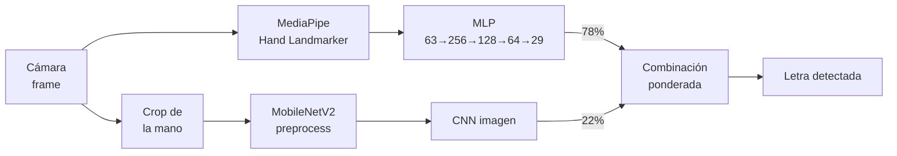

# Señas Al Aire

Aplicación web en Django para clasificar posturas del alfabeto ASL (American Sign Language) con la cámara del dispositivo mediante un sistema híbrido de redes neuronales. La salida es experimental y no representa una medición general de precisión.

Este documento describe la API, los modelos, la instalación y el despliegue del sistema con una estructura de manual técnico orientada a la entrega académica.

## Documentación técnica

- [Manual técnico en Word, basado en la plantilla GradeBoost-API](docs/manual_tecnico_senas_al_aire.docx)
- [Manual técnico en Markdown](docs/manual_tecnico_senas_al_aire.md)
- [Repositorio de referencia GradeBoost-API](https://github.com/jose-llanos/GradeBoost-API)

## Descripción

El sistema combina dos modelos de deep learning para lograr un reconocimiento robusto de las 29 clases del alfabeto ASL (A-Z, del, nothing, space):

1. **CNN MobileNetV2** con transfer learning, entrenada sobre el dataset `grassknoted/asl-alphabet` de Kaggle.
2. **MLP (perceptrón multicapa)** entrenado sobre landmarks de la mano extraídos con **MediaPipe Hand Landmarker**.
3. **Sistema híbrido**: combinación ponderada (78% landmarks + 22% CNN) para la predicción final.

### Características

- Reconocimiento en tiempo real a través de la cámara.
- Construcción de palabras letra por letra.
- Síntesis de voz (Web Speech API) con acento español.
- Panel de sensibilidad ajustable (Precisa/Normal/Rápida).
- Entrenamiento y evaluación local del modelo.
- 3 gráficas de resultados: matriz de confusión, precisión por clase, distribución de confianza.
- Preparado para despliegue en Render (inferencia sin reentrenar).

### Base para senas dinamicas

La aplicacion conserva las letras estaticas y ya incluye una ruta temporal para
recibir ventanas de 32 frames con landmarks. Las diez clases iniciales son:
`hello`, `thank_you`, `sorry`, `help`, `please`, `yes`, `no`, `water`, `good` y
`bad`.

Para entrenar localmente, prepara un archivo NPZ con `sequences` de forma
`(ejemplos, frames, 21, 3)` y `labels` con indices de 0 a 9, y ejecuta:

```powershell
python -m proyecto.ml.prepare_wlasl --max-per-class 10 --frames 32
python -m proyecto.ml.prepare_hf_video_dataset --max-per-class 10 --frames 32
python -m proyecto.ml.train_dynamic --input data/dynamic_sequences.npz data/dynamic_sequences_hf.npz
```

El modelo generado se guarda en `proyecto/models/asl_dynamic_gru.keras`.
Mientras ese archivo no exista, `/sequence_predict/` responde `503` para no
mostrar predicciones inventadas. El dataset de videos debe descargarse y
usarse conforme a su licencia; no debe subirse completo al despliegue.

El primer modelo generado localmente con el piloto de WLASL es experimental:
solo contiene una secuencia por clase y no debe considerarse preciso. Para una
version publicable se necesitan varias personas y varias muestras por cada
clase, con una validacion separada por signante.

El segundo preparador usa videos ASL alojados directamente en Hugging Face y
solo descarga las clases solicitadas. Verifica siempre la licencia y el estado
del dataset antes de publicar un modelo entrenado con sus videos.

## Probar la aplicacion desplegada

La version desplegada esta disponible en:

https://se-as-al-aire-1.onrender.com

Importante:

- Como el servicio esta desplegado en el plan free de Render, si no recibe peticiones por un tiempo se apaga automaticamente.
- Cuando alguien abra la URL, es posible que tenga que esperar al menos 1 minuto mientras Render recibe la peticion y vuelve a levantar el servicio.

## Arquitectura del sistema



## API RESTful

La aplicación expone rutas HTTP mediante Django. Las respuestas de inferencia se entregan en JSON; la página principal y `/prediccion/` renderizan HTML. La referencia completa está en este README y en los manuales [Word](docs/manual_tecnico_senas_al_aire.docx) y [Markdown](docs/manual_tecnico_senas_al_aire.md). No se genera Swagger UI, ReDoc ni un esquema OpenAPI. Las solicitudes POST están protegidas por CSRF: primero solicita `GET /` para obtener la cookie `csrftoken` y envíala junto con el encabezado `X-CSRFToken`.

### `GET /` — Estado de la aplicación

Renderiza la interfaz web principal, entrega la cookie CSRF y muestra si los modelos estáticos y dinámicos están disponibles.

### `POST /camera_predict/` — Reconocer una imagen de cámara

Recibe una imagen codificada en Base64 y retorna la predicción híbrida basada en landmarks y apariencia visual.

**Request body**

```json
{
    "image": "data:image/jpeg;base64,/9j/4AAQSkZJRgABAQ..."
}
```

**Respuesta `200 OK`**

```json
{
    "predicted": "A",
    "raw_label": "a",
    "confidence": "0.95",
    "action": "letter",
    "token": "a",
    "hand_detected": true,
    "preprocess_mode": "mediapipe-landmarks",
    "prediction_mode": "hybrid-landmarks-image",
    "landmark_label": "a",
    "landmark_confidence": 0.96,
    "image_label": "a",
    "image_confidence": 0.91,
    "handedness": "Right",
    "landmarks": []
}
```

El campo `landmarks` contiene los puntos detectados cuando la respuesta incluye la información completa de la mano. La respuesta real puede variar según la imagen y la detección obtenida.

**Ejemplo con `curl`**

```powershell
curl.exe -c cookies.txt http://127.0.0.1:8000/

curl.exe -X POST http://127.0.0.1:8000/camera_predict/ `
    -b cookies.txt `
    -H "Content-Type: application/json" `
    -H "X-CSRFToken: <csrf-token>" `
    -d '{"image":"data:image/jpeg;base64,<base64-de-la-imagen>"}'
```

El endpoint limita la imagen decodificada a 2 MiB y a 2.000.000 píxeles; además, rechaza cuerpos de solicitud mayores de 4 MiB. El límite de frecuencia configurado es de 10 solicitudes por segundo y dirección IP mediante la caché de Django. Una solicitud rechazada por CSRF devuelve `403`.

### `POST /sequence_predict/` — Reconocer una seña dinámica

Recibe una lista de frames con 21 landmarks tridimensionales por frame. El sistema remuestrea la secuencia a 32 frames, genera 69 características por frame y ejecuta el modelo GRU.

**Request body**

```json
{
    "frames": [
        [
            [0.0, 0.0, 0.0], [0.0, 0.0, 0.0], [0.0, 0.0, 0.0],
            [0.0, 0.0, 0.0], [0.0, 0.0, 0.0], [0.0, 0.0, 0.0],
            [0.0, 0.0, 0.0], [0.0, 0.0, 0.0], [0.0, 0.0, 0.0],
            [0.0, 0.0, 0.0], [0.0, 0.0, 0.0], [0.0, 0.0, 0.0],
            [0.0, 0.0, 0.0], [0.0, 0.0, 0.0], [0.0, 0.0, 0.0],
            [0.0, 0.0, 0.0], [0.0, 0.0, 0.0], [0.0, 0.0, 0.0],
            [0.0, 0.0, 0.0], [0.0, 0.0, 0.0], [0.0, 0.0, 0.0]
        ]
    ]
}
```

El ejemplo usa valores cero solo para mostrar la forma del JSON; no representa una seña real ni una predicción útil. Cada frame real debe contener los 21 puntos detectados.

**Respuesta `200 OK`**

```json
{
    "predicted": "hello",
    "confidence": "0.87",
    "class_index": 0,
    "accepted": true
}
```

Cuando la confianza es inferior a `0.75`, la respuesta conserva el índice y la confianza, pero devuelve `"predicted": "no_reconocida"` y `"accepted": false`.

### `POST /prediccion/` — Entrenar o evaluar modelos

Ejecuta el flujo local de descarga de datos, entrenamiento y evaluación del modelo estático cuando `ALLOW_TRAINING=true`. En producción se encuentra deshabilitado y muestra un mensaje informativo en la interfaz.

## Manejo de errores

Las respuestas de error de los endpoints mantienen un formato JSON sencillo con el campo `error`:

```json
{
    "error": "El contenido debe ser JSON."
}
```

| Código | Causa |
|---:|---|
| `400` | JSON inválido, imagen ausente, frames vacíos o landmarks con formato incorrecto. |
| `403` | Solicitud POST rechazada por la protección CSRF de Django. |
| `405` | Método HTTP diferente de `POST` en un endpoint de inferencia. |
| `413` | Cuerpo de cámara superior a 4 MiB, imagen decodificada superior a 2 MiB o resolución mayor a 2.000.000 píxeles. |
| `415` | El contenido no usa `application/json`. |
| `429` | Se superó el límite de solicitudes del endpoint de cámara. |
| `500` | Error interno durante la inferencia. |
| `503` | El modelo dinámico todavía no existe o no cumple el tamaño mínimo. |

## Modelo de Machine Learning

El sistema utiliza tres componentes de aprendizaje automático:

| Componente | Modelo | Entrada | Salida |
|---|---|---|---|
| Clasificador visual | MobileNetV2 con transfer learning | Recorte RGB de la mano a 96×96 | 29 clases estáticas |
| Clasificador geométrico | MLP de landmarks | 63 valores `(21 × 3)` | 28 clases estáticas; excluye `nothing` |
| Clasificador temporal | GRU | 32 frames × 69 características | 10 señas dinámicas |

La predicción estática se calcula mediante la combinación:

```text
prediccion_final = 0.78 × prediccion_landmarks + 0.22 × prediccion_imagen
```

Las clases dinámicas son `hello`, `thank_you`, `sorry`, `help`, `please`, `yes`, `no`, `water`, `good` y `bad`.

El modelo dinámico se entrena con los preparadores de WLASL y Hugging Face y se guarda como `proyecto/models/asl_dynamic_gru.keras`. Su artefacto actual es experimental: requiere más muestras, varios signantes y una validación independiente por persona antes de presentarse como un resultado generalizable.

## Requisitos

- **Windows 10 o superior** (o Linux con dependencias OpenGL).
- **Python 3.11 o 3.12**.
- Conexión a internet en la primera ejecución (descarga dataset y modelos).
- Cámara web para inferencia en vivo.

## Instalación y ejecución local

```powershell
git clone https://github.com/beyner62838/se-as-al-el-aire.git
cd se-as-al-el-aire

py -3.12 -m venv .venv
.\.venv\Scripts\Activate.ps1

python -m pip install --upgrade pip
python -m pip install -r requirements.txt

python manage.py migrate
python manage.py runserver
```

Abre: http://127.0.0.1:8000/

## Uso

### Inferencia en tiempo real

1. Abre la aplicación en el navegador.
2. Presiona **"Abrir cámara"** y permite el acceso a la cámara.
3. Coloca la mano dentro del recuadro guía.
4. El reconocimiento comienza automáticamente.
5. Las letras detectadas se agregan a la palabra.
6. Presiona **"Detener cámara"** para pronunciar la palabra.

### Entrenamiento y evaluación

1. Presiona **"Entrenar o evaluar modelo"** (solo disponible en modo local).
2. El sistema descarga el dataset ASL Alphabet si es necesario.
3. Entrena o carga los modelos existentes.
4. Muestra: accuracy, loss, ejemplos de predicción y 3 gráficas de resultados.

## Gráficas de resultados

Al presionar "Entrenar o evaluar modelo", el sistema genera automáticamente:

| Gráfica | Descripción |
|---|---|
| **Matriz de confusión** | Heatmap de predicciones vs valores reales (validación) |
| **Precisión por clase** | Barras de accuracy por cada letra (verde ≥ 80%, amarillo ≥ 50%, rojo < 50%) |
| **Distribución de confianza** | Histograma comparativo: confianza en aciertos (verde) vs errores (rojo) |

Las gráficas se generan con matplotlib y se guardan en `proyecto/static/images/`.

## Despliegue en Render

El proyecto está configurado para desplegarse en Render:

### Variables de entorno

```text
PYTHON_VERSION=3.11.11
DEBUG=false
ALLOW_TRAINING=false
WEB_CONCURRENCY=4
DATABASE_URL=<internal database url de Render>
SECRET_KEY=<generado por Render>
ALLOWED_HOSTS=<tu-servicio>.onrender.com
```

### Comandos

- **Build:** `bash build.sh`
- **Start:** `python -m gunicorn proyecto.asgi:application -k uvicorn.workers.UvicornWorker`

> **Nota:** En producción el entrenamiento está desactivado. Los modelos vienen pre-entrenados en el repositorio.

La configuración usa variables de entorno para `SECRET_KEY`, `DEBUG` y hosts; WhiteNoise para estáticos y PostgreSQL cuando existe `DATABASE_URL`.

## Despliegue en Hugging Face Spaces

También se puede crear un Space de tipo **Docker** usando este repositorio. El
archivo `README.md` ya declara `sdk: docker` y el puerto `7860`; el contenedor
usa la variable `PORT`, por lo que sigue siendo compatible con Render.

En el Space configura como secretos o variables:

```text
DEBUG=false
ALLOW_TRAINING=false
SECRET_KEY=<clave-larga-y-segura>
ALLOWED_HOSTS=<tu-space>.hf.space
```

Sube solamente los modelos entrenados y los archivos de soporte. El dataset,
`.venv`, cachés y la base de datos local quedan excluidos por `.gitignore` y
`.dockerignore`. El plan gratuito puede dormir el Space y tiene recursos
limitados; debe medirse la latencia antes de usarlo como servicio permanente.

## Estructura del proyecto

```
django_deep_learning/
├── manage.py                     # Entry point de Django
├── requirements.txt              # Dependencias
├── Dockerfile                    # Imagen Docker para Render
├── build.sh                      # Script de build para Render
├── proyecto/
│   ├── __init__.py
│   ├── settings.py               # Configuración de Django
│   ├── urls.py                   # Enrutamiento de URLs
│   ├── views.py                  # Lógica del sistema híbrido
│   ├── asgi.py / wsgi.py         # Interfaces de servidor
│   ├── models/                   # Modelos pre-entrenados
│   │   ├── asl_alphabet_mobilenet_v2.keras
│   │   ├── asl_alphabet_class_names.json
│   │   ├── asl_landmarks_mlp.keras
│   │   ├── asl_landmarks_metadata.json
│   │   ├── asl_dynamic_gru.keras
│   │   ├── asl_dynamic_class_names.json
│   │   └── hand_landmarker.task
│   ├── ml/                       # Preparación, entrenamiento e inferencia ML
│   │   ├── sequence_dataset.py
│   │   ├── sequence_inference.py
│   │   ├── temporal_model.py
│   │   ├── prepare_wlasl.py
│   │   ├── prepare_hf_video_dataset.py
│   │   └── train_dynamic.py
│   ├── templates/
│   │   └── index.html            # Interfaz de usuario
│   ├── static/
│   │   ├── css/style.css         # Estilos
│   │   └── images/               # Gráficas generadas
│   └── datasets/                 # Dataset (no versionado)
│       └── asl_alphabet/
└── staticfiles/                  # Estáticos recogidos (no versionado)
```

## Archivos versionados vs ignorados

### Versionados (para Render)

En Render la app solo se usa para inferencia. El entrenamiento y la evaluación grande quedan pensados para local, no para producción.

- `proyecto/models/asl_alphabet_mobilenet_v2.keras`
- `proyecto/models/asl_alphabet_class_names.json`
- `proyecto/models/asl_landmarks_mlp.keras`
- `proyecto/models/asl_landmarks_metadata.json`
- `proyecto/models/asl_dynamic_gru.keras`
- `proyecto/models/asl_dynamic_class_names.json`
- `proyecto/models/hand_landmarker.task`

### Ignorados (regenerables o pesados)

- `proyecto/datasets/` (se descarga de Kaggle)
- `proyecto/.cache/` (caché de MediaPipe/matplotlib)
- `proyecto/models/asl_landmarks_dataset_v1.npz` (se regenera)
- `db.sqlite3` (base de datos local)
- Entornos virtuales (`.venv/`, `.venv312/`, `myenv/`)

## Tecnologías utilizadas

| Tecnología | Versión | Propósito |
|---|---|---|
| Django | 4.1 | Framework web |
| TensorFlow | ≥2.16 | Redes neuronales (CNN + MLP) |
| MediaPipe | ≥0.10.33 | Detección de manos y landmarks |
| MobileNetV2 | - | CNN pre-entrenada (transfer learning) |
| Gunicorn + Uvicorn | - | Servidor ASGI para Render |
| WhiteNoise | ≥6.9 | Servir estáticos en producción |
| PostgreSQL | - | Base de datos en producción |
| matplotlib | ≥3.8 | Generación de gráficas |
| scikit-learn | ≥1.3 | Métricas de evaluación |
| kagglehub | ≥0.3 | Descarga del dataset |

## Créditos

- **Dataset:** [grassknoted/asl-alphabet](https://www.kaggle.com/datasets/grassknoted/asl-alphabet) en Kaggle.
- **MediaPipe:** [Hand Landmarker](https://ai.google.dev/edge/mediapipe/solutions/vision/hand_landmarker) de Google.
- **MobileNetV2:** [Sandler et al., 2018](https://arxiv.org/abs/1801.04381).
