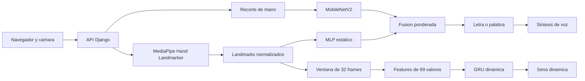

# Manual tecnico
## Señas Al Aire

**Documento:** manual tecnico de la aplicacion web y sus modelos de reconocimiento
**Version:** 1.0
**Fecha:** 2 de septiembre de 2026

## 1. Datos de identificacion

- **Nombre del proyecto:** Señas Al Aire.
- **Tipo de sistema:** aplicacion web para reconocimiento de señas ASL.
- **Framework principal:** Django.
- **Lenguaje:** Python.
- **Entrada principal:** video capturado desde la camara del navegador.
- **Salida principal:** letras, palabras y señas dinamicas reconocidas.
- **Repositorio y version:** [Completar URL, commit y fecha].

## 2. Objetivo

Describir la instalacion, arquitectura, funcionamiento y mantenimiento de Señas Al Aire. El sistema reconoce posturas estaticas y señas dinamicas mediante deteccion de landmarks, modelos de aprendizaje automatico y una interfaz web.

## 3. Alcance funcional

El sistema permite:

1. solicitar acceso a la camara desde el navegador;
2. detectar una mano y sus 21 landmarks tridimensionales;
3. clasificar letras del alfabeto ASL mediante una ruta hibrida;
4. construir palabras con las letras detectadas;
5. procesar ventanas temporales para reconocer diez señas dinamicas;
6. rechazar predicciones con confianza insuficiente;
7. pronunciar la palabra mediante la sintesis de voz del navegador;
8. entrenar o evaluar modelos en un entorno local habilitado;
9. ejecutarse en un contenedor Docker compatible con Render y Hugging Face Spaces.

## 4. Arquitectura general



## 5. Componentes del sistema

### 5.1 Capa web

La aplicacion Django se configura en `proyecto/settings.py`, define las rutas en `proyecto/urls.py` y concentra la logica de procesamiento en `proyecto/views.py`.

Las rutas principales son:

| Ruta | Metodo | Funcion |
|---|---|---|
| `/` | GET | Pagina principal con la interfaz de camara. |
| `/main/` | GET | Alias de la pagina principal. |
| `/prediccion/` | GET/POST | Entrenamiento o evaluacion del modelo estatico. |
| `/camera_predict/` | POST | Prediccion de una imagen de camara. |
| `/sequence_predict/` | POST | Prediccion de una secuencia de landmarks. |

### 5.2 Deteccion de la mano

`proyecto/ml/hand_detector.py` utiliza MediaPipe Hand Landmarker. Para cada cuadro produce hasta 21 puntos con coordenadas `x`, `y` y `z`. Cuando no se detecta una mano, la aplicacion conserva el estado de ausencia y evita presentar una prediccion valida.

### 5.3 Reconocimiento estatico

El reconocimiento estatico usa dos rutas:

- **Ruta de landmarks:** normaliza 63 coordenadas y las entrega al MLP `asl_landmarks_mlp.keras`.
- **Ruta de imagen:** recorta la mano, ajusta la imagen y la entrega a MobileNetV2 `asl_alphabet_mobilenet_v2.keras`.

Las probabilidades se combinan con los pesos definidos en `proyecto/ml/constants.py`: 78% para landmarks y 22% para imagen.

### 5.4 Reconocimiento dinamico

El modulo dinamico esta compuesto por:

| Archivo | Responsabilidad |
|---|---|
| `proyecto/ml/sequence_dataset.py` | Valida, interpola y transforma las secuencias. |
| `proyecto/ml/sequence_inference.py` | Prepara la entrada y ejecuta la inferencia temporal. |
| `proyecto/ml/temporal_model.py` | Construye la red recurrente GRU. |
| `proyecto/ml/prepare_wlasl.py` | Prepara secuencias a partir de WLASL. |
| `proyecto/ml/prepare_hf_video_dataset.py` | Prepara secuencias desde videos de Hugging Face. |
| `proyecto/ml/train_dynamic.py` | Entrena y guarda el modelo temporal. |

Cada secuencia se remuestrea a 32 frames. Por cada frame se calculan 63 coordenadas normalizadas, 3 coordenadas de posicion relativa de la muñeca y 3 valores de velocidad relativa. La entrada de la GRU tiene forma `(32, 69)`.

La arquitectura utiliza dos capas GRU, dropout y una capa `softmax` de diez clases. Las clases actuales son `hello`, `thank_you`, `sorry`, `help`, `please`, `yes`, `no`, `water`, `good` y `bad`.

La confianza minima esta definida por `DYNAMIC_PREDICTION_THRESHOLD` y actualmente es `0.75`. Una prediccion inferior se devuelve como `no_reconocida`.

## 6. Flujo de operacion

### 6.1 Prediccion estatica

1. El navegador obtiene un cuadro de la camara.
2. El cliente lo envia como JSON a `/camera_predict/`.
3. Django valida el metodo, contenido, tamaño y frecuencia de la solicitud.
4. MediaPipe detecta los landmarks.
5. El MLP y MobileNetV2 producen sus probabilidades.
6. La aplicacion fusiona las probabilidades y aplica el umbral.
7. La respuesta incluye etiqueta, confianza, accion, modo de procesamiento y landmarks.

### 6.2 Prediccion dinamica

1. El cliente acumula frames con landmarks.
2. La lista se envia a `/sequence_predict/`.
3. Django verifica que exista un modelo temporal valido.
4. La secuencia se remuestrea y se convierte en 69 features por frame.
5. La GRU calcula las probabilidades de las diez clases.
6. La API devuelve la clase, el indice, la confianza y el estado `accepted`.

## 7. Instalacion local

Requisitos: Windows 10 o superior, o Linux con dependencias graficas; Python 3.11 o 3.12; camara web; y conexion a internet para descargar datasets o modelos faltantes.

```powershell
py -3.12 -m venv .venv
.\\.venv\\Scripts\\Activate.ps1
python -m pip install --upgrade pip
python -m pip install -r requirements.txt
python manage.py migrate
python manage.py runserver
```

La aplicacion queda disponible en `http://127.0.0.1:8000/`.

## 8. Preparacion y entrenamiento dinamico

Los preparadores generan archivos NPZ con `sequences` de forma `(ejemplos, frames, 21, 3)` y `labels` con indices de 0 a 9.

```powershell
python -m proyecto.ml.prepare_wlasl --max-per-class 10 --frames 32
python -m proyecto.ml.prepare_hf_video_dataset --max-per-class 10 --frames 32
python -m proyecto.ml.train_dynamic --input data/dynamic_sequences.npz data/dynamic_sequences_hf.npz
```

El modelo se guarda en `proyecto/models/asl_dynamic_gru.keras` y las clases en `proyecto/models/asl_dynamic_class_names.json`.

El modelo entrenado actualmente es experimental. El archivo NPZ local validado contiene 32 secuencias de 32 frames; esto no constituye una medicion de precision general. Para publicar resultados se necesitan mas muestras, varios signantes y una particion de prueba separada por persona.

## 9. Modelos y archivos de soporte

| Archivo | Uso |
|---|---|
| `asl_alphabet_mobilenet_v2.keras` | Clasificacion visual de letras. |
| `asl_alphabet_class_names.json` | Clases del modelo visual. |
| `asl_landmarks_mlp.keras` | Clasificacion geometrica de letras. |
| `asl_landmarks_metadata.json` | Metadatos del modelo de landmarks. |
| `asl_dynamic_gru.keras` | Clasificacion temporal de diez señas. |
| `asl_dynamic_class_names.json` | Clases del modelo temporal. |
| `hand_landmarker.task` | Modelo de deteccion MediaPipe. |

Los modelos se cargan bajo demanda y se mantienen en cache para evitar recargas en cada solicitud.

## 10. Pruebas y validacion

Las pruebas de regresion se encuentran en `proyecto/tests.py`. Incluyen validacion de metodos HTTP, tipo de contenido, JSON, CSRF, ausencia del modelo dinamico, trayectoria, velocidad y formas invalidas de landmarks.

```powershell
python manage.py test proyecto.tests --verbosity 1
```

La validacion local confirmo que el modelo dinamico carga correctamente, recibe `(None, 32, 69)` y produce `(None, 10)`. Tambien se ejecutaron cinco pruebas del modulo temporal con resultado `OK`. Estas comprobaciones no sustituyen una evaluacion con un conjunto de prueba independiente.

## 11. Despliegue

El proyecto incluye `Dockerfile` y `build.sh`. En produccion se recomienda `DEBUG=false`, `ALLOW_TRAINING=false`, una `SECRET_KEY` segura y un `ALLOWED_HOSTS` configurado. Deben incluirse solo modelos y archivos de soporte; los datasets completos, caches, entornos virtuales y la base de datos local deben excluirse.

El entrenamiento se ejecuta localmente. El servicio desplegado carga los modelos existentes y se limita a la inferencia.

## 12. Limitaciones conocidas

1. El modelo dinamico actual tiene pocas muestras y es experimental.
2. Las clases dinamicas no cubren todo el vocabulario ASL.
3. La precision puede variar con iluminacion, fondo, distancia, oclusion y signante.
4. La licencia y procedencia de cada dataset deben verificarse antes de publicar modelos.
5. Render puede suspender temporalmente el servicio en el plan gratuito.

## 13. Mantenimiento

Antes de cada entrega se debe ejecutar las pruebas de Django, comprobar que los archivos `.keras` abren correctamente, validar que las clases coinciden con sus JSON, revisar datasets y registrar Python, dependencias, commit y fecha de entrenamiento.

## 14. Pendientes

- [ ] Incorporar URL, commit y responsable del proyecto.
- [ ] Anexar metricas reproducibles de accuracy, precision, recall y F1.
- [ ] Añadir matriz de confusion y curvas de entrenamiento.
- [ ] Registrar licencias de WLASL y Hugging Face.
- [ ] Documentar pruebas con personas no incluidas en el entrenamiento.
- [ ] Incorporar capturas o figuras finales de la interfaz.